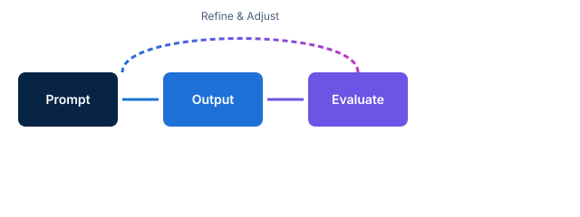

<!-- course-title: Prompt Engineering for Generative AI -->
<!-- course-theme: roi-alt-theme -->

<!-- layout: title -->


Prompt Engineering for Generative AI

# Chapter 1: Prompt Engineering Fundamentals

---

# Chapter 1: Objectives

- Understand core prompt engineering principles and how large language models interpret instructions
- Explore core principles of effective prompts
- Apply context, constraints, and examples
- Practice iterative refinement and chain-of-thought reasoning
- Complete hands-on prompt engineering exercises in Gemini

---

<!-- layout: navigation -->
# Chapter 1

- **Introduction to Generative AI and Prompting**
- Core Principles of Effective Prompts
- Context, Constraints, and Examples
- Iterative Refinement
- Lab: Prompt Engineering with Gemini

---

# What is Prompt Engineering?

- **Prompting is programming**: instructions guide the model toward the desired output
- **Generative AI models**: predict the most likely next token based on input patterns
- **Vague inputs lead to vague results**: clear guidance transforms generic responses into targeted answers
- **Why it matters**: bridges the gap between raw model capability and practical business utility

> [!NOTE]
> Large language models do not think like humans; they pattern-match across vast training data based on your exact phrasing.

---

# Do Now: Write a Request for Help

Try this before the explanation.

- Open Gemini in your browser
- Write a prompt asking for help explaining a technical concept to a non-technical manager
- Note what information was missing or what the model assumed about your audience

---

# Discuss: Why Did the Model Guess?

- Look at the response you got from your initial prompt
- Discuss with your neighbor:
  - What did the model assume about tone or length?
  - Where did it add unnecessary fluff?
  - What single detail, if added to your prompt, would have fixed it instantly?

---

<!-- layout: 2-column -->
# Direct Instruction vs Loose Query

### Loose Query
- "Write an email about our project."
- Results in generic tone, wrong length, and missing key details
- Requires extensive follow-up questions

### Structured Prompt
- "Write a 3-paragraph status update email to the executive team about the Q3 migration project, highlighting the successful database cutover."
- Delivers precise tone, exact length, and necessary context immediately

---

# Anatomy of a Prompt

- **Role / Persona**: telling the model who it is acting as (e.g., expert technical writer)
- **Task**: the core action or request you want performed
- **Context**: background information, audience, and setting
- **Constraints**: length limits, forbidden words, or formatting rules
- **Examples**: few-shot demonstration of desired input and output

> [!TIP]
> Group these components logically in your prompt using clear headings or bullet points for complex tasks.

---

<!-- layout: navigation -->
# Chapter 1

- Introduction to Generative AI and Prompting
- **Core Principles of Effective Prompts**
- Context, Constraints, and Examples
- Iterative Refinement
- Lab: Prompt Engineering with Gemini

---

# Core Principles of Effective Prompts

- **Be specific and explicit**: replace general terms with precise requirements
- **Use positive framing**: tell the model what to do rather than what to avoid when possible
- **Divide and conquer**: break complex multi-step workflows into smaller, sequential prompts
- **Format the output**: specify tables, bullet points, or JSON structures explicitly

> [!IMPORTANT]
> If a model fails to follow instructions, check whether your prompt gave competing directions or buried the core task in conversational filler.

---

<!-- layout: 3-column -->
# Clarity Techniques

### Precision
- Name the exact audience, tone, and format
- Avoid ambiguous modifiers like "make it good"

### Structure
- Use markdown, headers, and numbered lists
- Separate instructions from input data clearly

### Simplicity
- Remove unnecessary conversational fluff
- Keep instructions direct and unambiguous
- Focus on a single primary goal per prompt

---

# Handling Ambiguity and Hallucinations

- **What is a hallucination**: models generating plausible-sounding but completely incorrect facts
- **Root causes**: underspecified prompts, missing constraints, or lack of grounding data
- **Mitigation strategies**:
  - Instruct the model to say "I do not know" if information is missing
  - Provide source text and ask the model to answer only using that text
  - Request citations or step-by-step reasoning

> [!WARNING]
> Never rely on unverified generative AI output for critical financial, legal, or medical decisions without human review.

---

<!-- layout: navigation -->
# Chapter 1

- Introduction to Generative AI and Prompting
- Core Principles of Effective Prompts
- **Context, Constraints, and Examples**
- Iterative Refinement
- Lab: Prompt Engineering with Gemini

---

# Setting Context and Role

- **Role prompting**: assigns a professional persona to calibrate vocabulary and perspective
- **Background context**: explains why you need the output and who will read it
- **Audience tuning**: ensures the explanation matches beginner, expert, or executive levels

> [!NOTE]
> Saying "Act as a senior DevOps engineer explaining Kubernetes to a junior developer" instantly shifts the technical depth and tone.

---

<!-- layout: 2-column -->
# Constraints and Formatting

### Constraints
- Limit length ("under 200 words")
- Restrict vocabulary ("no jargon")
- Enforce safety or policy boundaries

### Formatting
- Markdown tables for comparisons
- Bulleted lists for action items
- JSON or CSV for programmatic parsing

---

# Few-Shot Prompting with Examples

- **Zero-shot**: asking the model to perform a task with zero examples
- **Few-shot**: providing 2 to 3 input-output examples before the actual request
- **Why it works**: examples establish pattern rhythm and formatting expectations faster than abstract rules

```text
Example 1:
Input: "Fix the bug in login.py" -> Category: Bugfix (Low Priority)

Example 2:
Input: "Implement OAuth2 SSO integration" -> Category: Feature (High Priority)

Input: "Update documentation for API endpoints" -> Category:
```

---

<!-- layout: navigation -->
# Chapter 1

- Introduction to Generative AI and Prompting
- Core Principles of Effective Prompts
- Context, Constraints, and Examples
- **Iterative Refinement**
- Lab: Prompt Engineering with Gemini

---

# The Iterative Prompting Loop

- **First attempt**: rarely perfect; treat prompt writing as an iterative design process
- **Diagnose failures**: identify whether the model misunderstood instructions, lacked context, or ignored constraints
- **Refine and test**: adjust prompt wording, add a clarifying constraint, or supply an example, then re-run

> [!TIP]
> Keep a prompt scratchpad or version history to track which wording changes produce the best results in Gemini.

---

<!-- layout: stacked -->
# Analyzing and Fixing Weak Prompts

- **Diagnosis**: analyze why the output missed the mark (too brief, wrong tone, missing data)
- **Adjustment**: add explicit boundaries or step-by-step reasoning prompts
- **Verification**: test across multiple variations to ensure reliable output quality



---

# Chain-of-Thought and Reasoning

- **Step-by-step guidance**: ask the model to "think step by step before answering"
- **Complex problem solving**: dramatically improves accuracy in math, logic, and multi-part analysis
- **Transparency**: lets you inspect the model's intermediate logic to catch flaws early

> [!IMPORTANT]
> Forcing intermediate reasoning prevents the model from jumping straight to a premature, incorrect conclusion.

---

<!-- layout: navigation -->
# Chapter 1

- Introduction to Generative AI and Prompting
- Core Principles of Effective Prompts
- Context, Constraints, and Examples
- Iterative Refinement
- **Lab: Prompt Engineering with Gemini**

---

# Lab: Prompt Engineering with Gemini

Lab link: TODO

---

# What You Learned

- Understood core prompt engineering principles and how large language models interpret instructions
- Mastered core principles of effective prompts
- Applied context, constraints, and few-shot examples
- Practiced iterative refinement and chain-of-thought reasoning
- Completed hands-on prompt engineering exercises in Gemini

---

# Quiz 1 of 3

**Why do vague prompts often produce unsatisfactory results from generative AI models?**

- A. Models automatically execute code without user permission
- B. Large language models rely on pattern-matching across training data and lack human intuition to guess missing intent
- C. Models only accept prompts written in Python
- D. Vague prompts automatically trigger system hallucinations

---

# Quiz 1: Answer

**Why do vague prompts often produce unsatisfactory results from generative AI models?**

**Correct: B.** Large language models rely on pattern-matching across training data and lack human intuition to guess missing intent

- Models predict the most likely next tokens based on the input text provided
- Without specific context, constraints, or formatting rules, the model falls back on generic averages
- Clear instructions narrow the probability distribution toward the desired output
- Prompt engineering bridges the gap between raw capability and precise results

---

# Quiz 2 of 3

**What is the primary benefit of few-shot prompting (providing examples)?**

- A. It reduces API token consumption to zero
- B. It prevents the model from ever generating incorrect facts
- C. It establishes clear pattern rhythm, formatting, and style expectations faster than abstract rules alone
- D. It bypasses security guardrails and safety filters

---

# Quiz 2: Answer

**What is the primary benefit of few-shot prompting (providing examples)?**

**Correct: C.** It establishes clear pattern rhythm, formatting, and style expectations faster than abstract rules alone

- Providing 2 to 3 input-output pairs demonstrates the exact structure you expect
- Models excel at mimicking patterns shown in the immediate context window
- Few-shot examples reduce ambiguity when instructing complex classification or formatting tasks
- It complements clear roles and constraints

---

<!-- layout: 2-column -->
# Quiz 3 of 3: Discussion

### Prompt
Your team is frustrated because Gemini keeps giving overly verbose answers when asked technical troubleshooting questions.

### Discuss
- What constraints or formatting rules would you add to the prompt?
- How could role prompting or few-shot examples help?
- Why is iterative refinement necessary instead of relying on a single prompt?

---

<!-- layout: 2-column -->
# Quiz 3: Discussion Points

**Your team is frustrated because Gemini keeps giving overly verbose answers when asked technical troubleshooting questions.**

### Strong Answers Mention
- Adding explicit length and formatting constraints ("under 150 words, bulleted steps only")
- Using role prompting ("act as a concise senior systems administrator")
- Supplying a short, concise troubleshooting example (few-shot prompting)
- Refining the prompt iteratively based on output testing in Gemini

### Watch For
- Assuming the first prompt is always final
- Relying on vague instructions like "keep it short" without defining format
- Ignoring model context window limits

---

# Questions and Answers

Questions?
